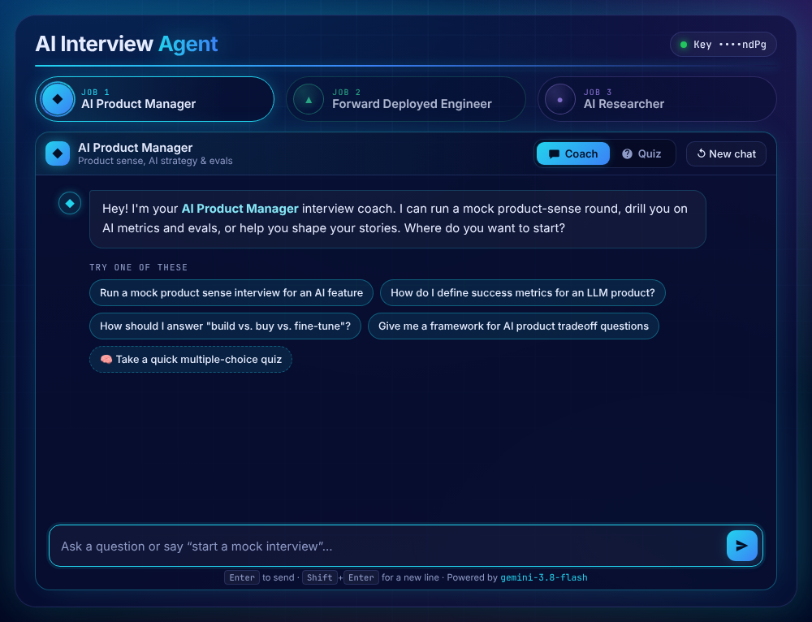
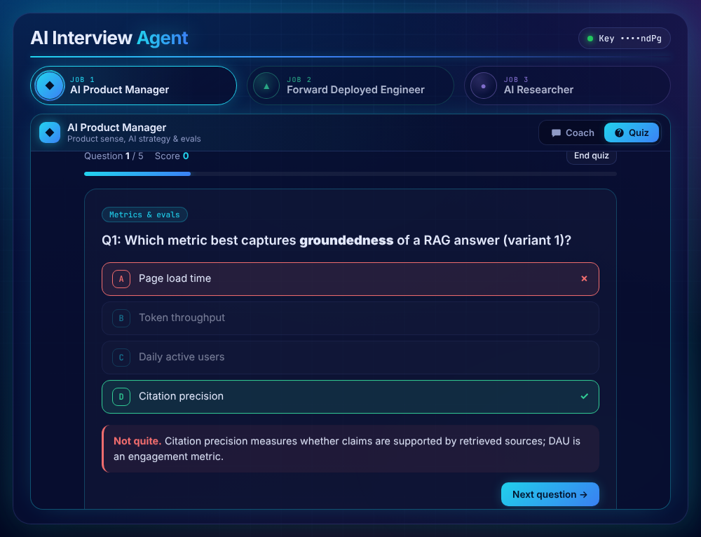
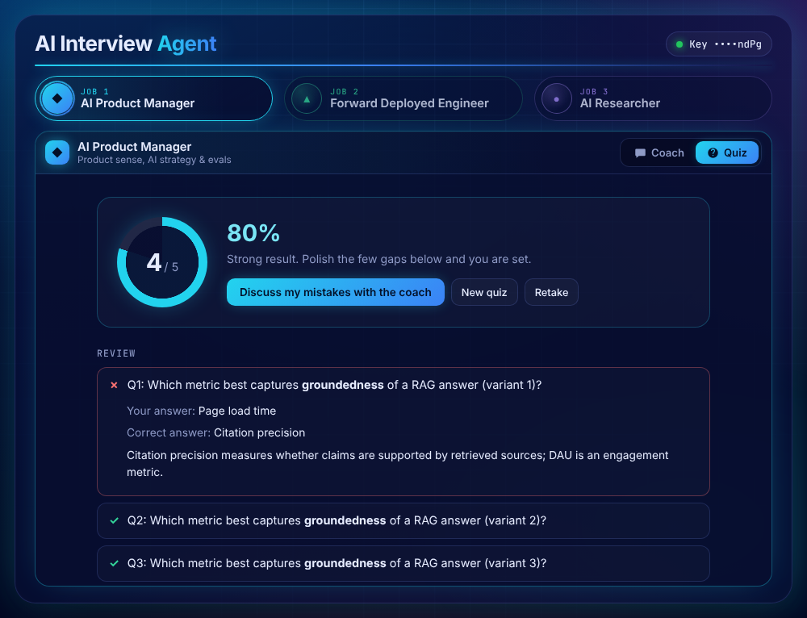
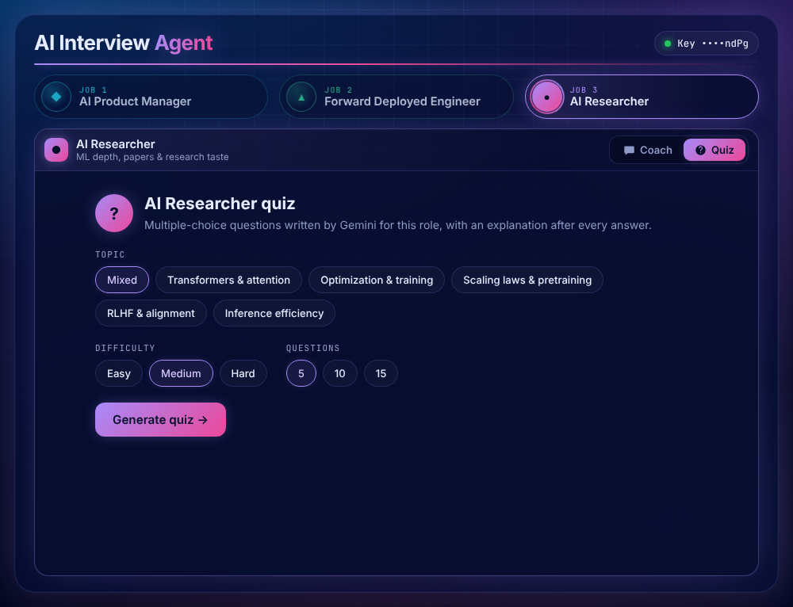

# AI Interview Agent

An AI chatbot that helps you prepare for interviews for AI roles:

1. **AI Product Manager**: product sense for AI features, metrics and evals, build vs. buy vs. fine-tune, strategy
2. **Forward Deployed Engineer**: customer scenarios, applied LLM/RAG system design, practical coding, debugging
3. **AI Researcher**: ML and transformer fundamentals, research discussions, ML coding, presenting past work

Pick the job you're interviewing for and the app switches persona, starter prompts and color theme. Each job keeps its own conversation and quiz, so you can switch back and forth without losing progress.

There are two modes for each job:

- **Coach**: chat with an interview coach. Ask it to *"start a mock interview"* and it acts as the interviewer: one question at a time, with feedback and a score on each answer. Long replies stay pinned to their start while they stream in, and a **Jump to latest** button appears when you scroll up.
- **Quiz**: generate a multiple-choice quiz for the role. Pick a topic (or *Mixed*), a difficulty (Easy / Medium / Hard) and 5, 10 or 15 questions. You get instant feedback with an explanation after each answer, a score and a full review at the end, plus:
  - **Discuss my mistakes with the coach** sends the questions you missed to the Coach chat for a walkthrough
  - **Retake** replays the same questions with the options shuffled again
  - Keyboard shortcuts: `A`–`D` or `1`–`4` to answer, `Enter` for the next question
  - Quizzes taken and your best score are saved per role in your browser



| Quiz | Results |
| --- | --- |
|  |  |



## Tech

- [Vite](https://vite.dev) + vanilla JavaScript (no framework)
- Google Gemini (`gemini-3.8-flash`): chat replies are streamed over SSE, and quizzes use structured JSON output (`responseSchema`), straight from the browser
- `marked` + `DOMPurify` render the markdown in replies safely

## Getting started

```bash
npm install
npm run dev
```

Open the URL Vite prints. On first load you'll be asked for a **Gemini API key** (get one at [Google AI Studio](https://aistudio.google.com/apikey)).

- The key is sent only to Google's Gemini API, directly from your browser. There is no backend.
- "Remember on this device" stores it in `localStorage`. Untick it to keep it for the current tab session only.
- Click the key pill in the top right to change or remove it.

## Build

```bash
npm run build     # outputs static files to dist/
npm run preview   # serve the production build locally
```

`dist/` is a static site and can be deployed to Vercel, Netlify, GitHub Pages, Cloudflare Pages, etc.

## Project structure

```
index.html        Layout: header, job tabs, Coach/Quiz workspace, API key modal
src/main.js       App state, chat rendering and scrolling, per-role history, key handling
src/quiz.js       Quiz mode: generation, validation, play, results and review
src/gemini.js     Gemini client: streaming chat + JSON generation (model name lives here)
src/roles.js      Role personas (system prompts), starter prompts, quiz topics, theme colors
src/style.css     Blue/neon gradient + grid background, per-role theming
```

To add a role, tune a persona or change quiz topics, edit `src/roles.js`. To change the model, edit `MODEL` in `src/gemini.js`.
