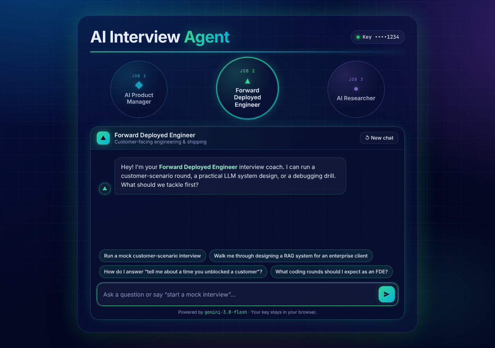

# AI Interview Agent

An AI chatbot that helps you prepare for interviews for AI roles:

1. **AI Product Manager**: product sense for AI features, metrics and evals, build vs. buy vs. fine-tune, strategy
2. **Forward Deployed Engineer**: customer scenarios, applied LLM/RAG system design, practical coding, debugging
3. **AI Researcher**: ML and transformer fundamentals, research discussions, ML coding, presenting past work

Pick the job you're interviewing for and the coach changes its persona, starter prompts and color theme. Each job keeps its own conversation, so you can switch back and forth without losing context. Ask it to *"start a mock interview"* and it will act as the interviewer: one question at a time, with feedback on each answer.


| Forward Deployed Engineer | AI Researcher |
| --- | --- |
|  |  |

## Tech

- [Vite](https://vite.dev) + vanilla JavaScript (no framework)
- Google Gemini (`gemini-3.8-flash`), with responses streamed over SSE straight from the browser
- `marked` + `DOMPurify` render the markdown in replies safely

## Getting started

```bash
npm install
npm run dev
```

Open the URL Vite prints. On first load you'll be asked for a **Gemini API key** (get one at [Google AI Studio](https://aistudio.google.com/apikey)).

- The key is sent only to Google's Gemini API, directly from your browser. There is no backend.
- "Remember on this device" stores it in `localStorage`. Untick it to keep it for the current tab session only.
- Click the key pill in the top right to change or remove it.

## Build

```bash
npm run build     # outputs static files to dist/
npm run preview   # serve the production build locally
```

`dist/` is a static site and can be deployed to Vercel, Netlify, GitHub Pages, Cloudflare Pages, etc.

## Project structure

```
index.html        Layout: header, job circles, chat box, API key modal
src/main.js       App state, rendering, per-role chat history, key handling
src/gemini.js     Gemini streaming client (model name lives here)
src/roles.js      Role personas (system prompts), starter prompts, theme colors
src/style.css     Blue/neon gradient + grid background, per-role theming
```

To add a role or tune a persona, edit `src/roles.js`. To change the model, edit `MODEL` in `src/gemini.js`.
